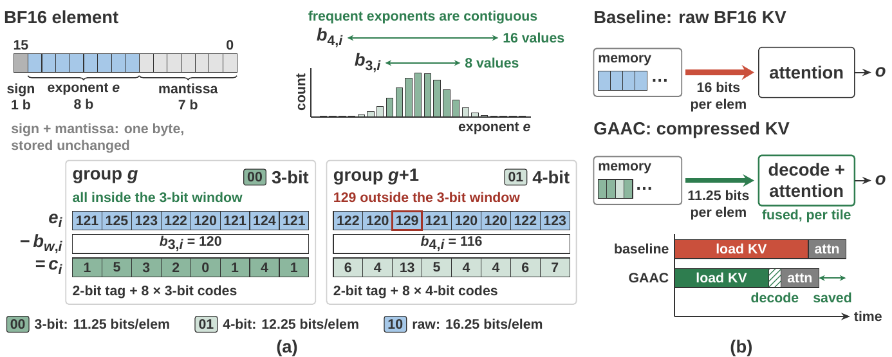
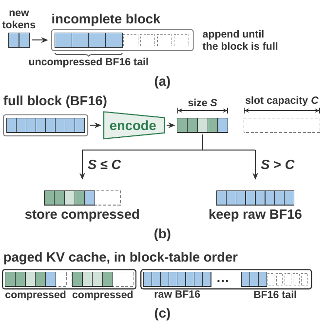
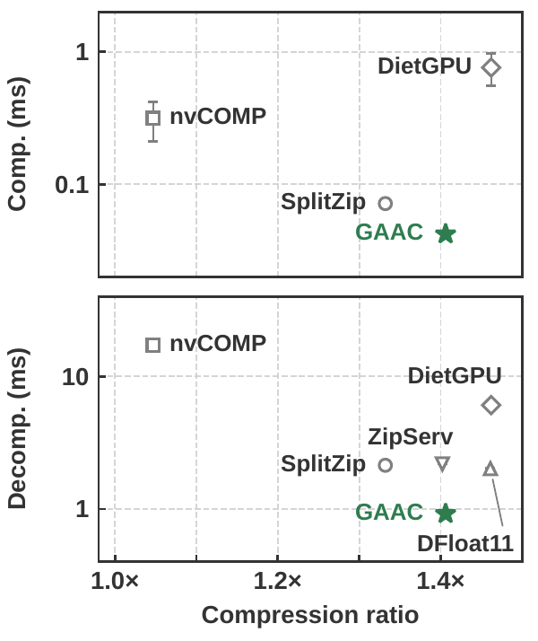
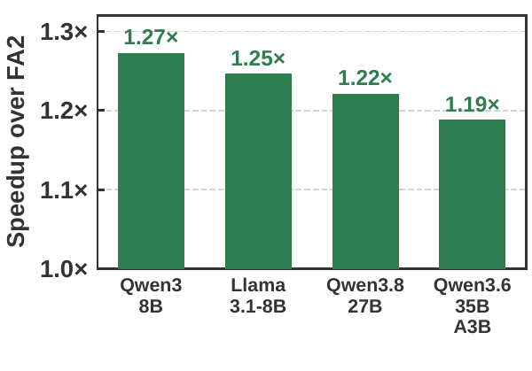
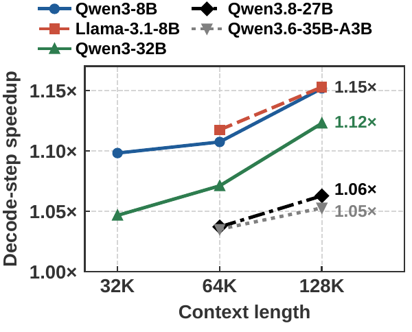

<div align="center">

# GAAC: Lossless KV Compression for Bandwidth-Efficient LLM Inference on Personal Devices

Yipin Guo, Arun M George, Siddharth Joshi

Department of Computer Science and Engineering, University of Notre Dame

<p>
  <a href="https://arxiv.org/abs/2610.38210"></a>
  <a href="LICENSE"></a>
  
  
  
</p>

</div>

---

## Abstract

Paper: [arXiv:2610.38210](https://arxiv.org/abs/2610.38210)

Weight-only, lossy quantization substantially reduces the storage and memory requirements for serving large language
models (LLMs), but the growing key-value (KV) cache remains a bottleneck for long-context inference on personal devices.
We present **Group-Adaptive Additive Codec (GAAC)**, a lossless KV compression and serving system that exploits exponent
redundancy to reduce storage and accelerate attention without introducing KV approximation. GAAC encodes BF16 exponents
using calibrated per-channel base-plus-offset codes over contiguous ranges, and adapts code widths across small groups
while preserving KV values bit-for-bit. A fused attention kernel reconstructs KV tiles on the fly, avoiding
full-cache decompression. Block-wise compression and fixed-capacity slots support incremental cache updates and paged
serving.

Across five tested models, GAAC achieves **1.405–1.407× lossless BF16 KV compression**. On an NVIDIA DGX Spark, it
accelerates decode attention at a 64K-token context by **1.19–1.27×** and end-to-end W4A16 decode steps by
**1.04–1.15×**. In serving, it reduces resident KV memory by about 26% and increases aggregate throughput by
**13–29%** under comparable KV-memory budgets.

## Overview

<p align="center"></p>

**(a) Format.** Sign and mantissa bytes are stored unchanged. Each exponent is coded as a 3-bit offset from a
calibrated per-channel base. An 8-element group that does not fit in the 3-bit window moves as a whole to a 4-bit
window or to raw exponents, recorded by a 2-bit tag per group. The common case costs 11.25 bits per element. **(b) Attention.** The fused kernel reads the compressed tiles and rebuilds BF16 values in registers, so
attention loads 11.25 bits per element instead of 16.

<p align="center"></p>

New tokens go to a BF16 tail. Each full 16-token block is encoded once into a fixed-capacity slot, or kept as raw
BF16 in the rare case it does not fit. The cache therefore supports incremental decoding and paging.

## Results from the paper

All measurements are on an NVIDIA DGX Spark (GB10), with W4A16 (AWQ) models in the end-to-end results.

**Compression across models.** Ratio is the BF16 size divided by the full compressed size, including tags and raw
fallbacks.

| Model | KV heads | Exponent entropy (bits) | Ratio | 3-bit groups | 4-bit groups | Raw groups |
| --- | :-: | :-: | :-: | :-: | :-: | :-: |
| Qwen3-4B | 8 | 2.78 | 1.405× | 89.0% | 10.8% | 0.2% |
| Qwen3-8B | 8 | 2.78 | 1.405× | 88.9% | 10.9% | 0.2% |
| Qwen3.8-27B | 4 | 2.69 | 1.405× | 88.3% | 11.5% | 0.2% |
| Qwen3.6-35B-A3B | 2 | 2.71 | 1.405× | 88.4% | 11.4% | 0.2% |
| Llama-3.1-8B | 8 | 2.70 | 1.407× | 89.9% | 9.9% | 0.2% |

<table>
  <tr>
    <td align="center" width="33%"><br>
      <sub><b>Codec comparison</b> on one Qwen3.8-27B layer. Compression is timed for one KV block and decompression
      for a 64K-token cache.</sub></td>
    <td align="center" width="33%"><br>
      <sub><b>Decode attention</b>: GAAC on compressed KV vs FlashAttention-2 on BF16 KV, batch 1, 64K
      context.</sub></td>
    <td align="center" width="33%"><br>
      <sub><b>End-to-end W4A16 decode step</b> vs the BF16-KV baseline, batch 1.</sub></td>
  </tr>
</table>

**Serving under equal KV-memory budgets.** With the memory it saves, GAAC fits one more long-context sequence:

| Model | Context | KV budget | BF16 KV: batch / tok/s | GAAC: batch / tok/s | Gain |
| --- | :-: | :-: | :-: | :-: | :-: |
| Qwen3-8B | 16K | 10 GB | 4 / 60.3 | 5 / 68.1 | +13% |
| Qwen3-8B | 64K | 20 GB | 2 / 19.0 | 3 / 22.8 | +20% |
| Qwen3-32B | 64K | 35 GB | 2 / 8.47 | 3 / 10.51 | +24% |
| Llama-3.1-8B | 64K | 18 GB | 2 / 20.0 | 3 / 24.9 | +25% |
| Qwen3.8-27B | 64K | 14 GB | 3 / 23.3 | 4 / 29.6 | +27% |
| Qwen3.6-35B-A3B | 64K | 5 GB | 3 / 62.9 | 4 / 81.3 | +29% |

---

## Installation

Platform: NVIDIA DGX Spark, with the CUDA toolkit (`nvcc`). The attention kernel is compiled on first use.

```bash
git clone https://github.com/Intelligent-Microsystems-Lab/GAAC.git && cd GAAC
conda create -n gaac python=3.10 -y && conda activate gaac
pip install -r requirements.txt
pip install -e .
```

If the kernel build does not detect the GPU, set the target before running: `export TORCH_CUDA_ARCH_LIST="12.1"`.

## Usage

### 1. Compress and decompress KV

```bash
python examples/compress_decompress.py                                  # synthetic KV
python examples/compress_decompress.py --input kv.pt --kind k --n-kv 8  # your own KV: bf16 tensor [heads, tokens, 128]
```

Prints the compression ratio, the share of 3-bit / 4-bit / raw groups, whether the round trip is bit-exact, and the
encode time.

### 2. Fused decode attention

```bash
python examples/attention.py --batch 1 --n-kv 8 --group 4 --context 65536
```

Prints the error against a reference attention and the time of GAAC on the compressed cache vs FlashAttention-2 on the
BF16 cache.

### 3. Generate with nano-vllm (Qwen3 dense, Llama-3.x)

nano-vllm loads models from a local folder:

```bash
huggingface-cli download Qwen/Qwen3-8B --local-dir ~/models/Qwen3-8B

# calibrate the exponent bases once per model (WikiText-2; use prompts as long as your context)
python examples/calibrate.py --model ~/models/Qwen3-8B --prompt-len 4096 --out qwen3_8b_bases.pt

# generate with the GAAC cache, then with the stock BF16 cache for comparison
python examples/generate.py --model ~/models/Qwen3-8B --bases qwen3_8b_bases.pt
python examples/generate.py --model ~/models/Qwen3-8B --kv none
```

`generate.py` prints the generated text and, for GAAC, the compressed vs BF16 KV size. Options: `--max-model-len`
(default 4096), `--max-tokens` (default 256), `--eager` (no CUDA graphs). Without `--bases`, each sequence calibrates
its own bases from its prompt.

In Python:

```python
from nanovllm import LLM, SamplingParams
llm = LLM("~/models/Qwen3-8B", kv_compression="gaac", gaac_bases="qwen3_8b_bases.pt",
          max_model_len=32768, max_num_batched_tokens=32768)
outputs = llm.generate(["Hello, my name is"], SamplingParams(temperature=0.6, max_tokens=256))
print(llm.model_runner.gaac_stats())
```

### 4. Generate with vLLM (Qwen3 dense, Qwen3.5/3.6/3.8)

This runs in NVIDIA's vLLM container for DGX Spark, `nvcr.io/nvidia/vllm:26.03-py3`: apply the patch in `vllm/`
and run `vllm/run_vllm.py`. Step-by-step instructions are in [`vllm/README.md`](vllm/README.md).

### 5. Tests

```bash
pytest tests
```

## Codec API

```python
import torch
from gaac import Codec, TileEncoder, attention

n_kv = 8
k = ...   # [n_kv, S, 128] bf16 K of one sequence (head-major); v likewise
ck = Codec(n_kv).calibrate(k_calibration)        # per-(head, channel) exponent bases
cv = Codec(n_kv).calibrate(v_calibration)
kp = TileEncoder("k").encode(ck, k)              # compressed page
vp = TileEncoder("v").encode(cv, v)

assert torch.equal(Codec.decode(kp).view(torch.int16), k.view(torch.int16))   # bit-exact round trip
print(kp.ratio)

q = ...   # [1, n_q, 128] bf16 decode query
o = attention(q, kp, vp, scale=128 ** -0.5)      # fused decode attention on the compressed pages
```

## Repository layout

| Path | Contents |
| --- | --- |
| `gaac/` | codec, Triton encoder, fused decode-attention CUDA kernel, compressed KV cache, calibration |
| `gaac/vllm/` | vLLM attention backend |
| `nanovllm/` | [nano-vllm](https://github.com/GeeeekExplorer/nano-vllm) v0.2.0 with the GAAC cache and Llama-3.x support |
| `vllm/` | vLLM patch for the `nvcr.io/nvidia/vllm:26.03-py3` container, run script, instructions |
| `examples/`, `tests/` | the scripts above, unit tests |

## Limitations

- nano-vllm: head_dim 128, GQA group size ≤ 8, single GPU; prefix caching and chunked prefill are off in GAAC mode.
- vLLM: head_dim 128 or 256.
- Each sequence's prompt plus `max_tokens` must fit in `max_model_len`.

## Citation

```bibtex
@misc{guo2026gaaclosslesskvcompression,
      title={GAAC: Lossless KV Compression for Bandwidth-Efficient LLM Inference on Personal Devices},
      author={Yipin Guo and Arun M George and Siddharth Joshi},
      year={2026},
      eprint={2610.38210},
      archivePrefix={arXiv},
      primaryClass={cs.AI},
      url={https://arxiv.org/abs/2610.38210},
}
```

## License

This project is released under the MIT License. See [`LICENSE`](LICENSE). The bundled nano-vllm keeps its own MIT
license (`nanovllm/LICENSE`).

## Acknowledgements

The serving engine is built on [nano-vllm](https://github.com/GeeeekExplorer/nano-vllm) by Xingkai Yu (MIT license,
see `nanovllm/LICENSE`). The exponent-window idea builds on
[SplitZip](https://github.com/Intelligent-Microsystems-Lab/SplitZip).
